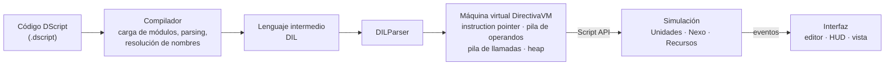

<p align="center">
  
</p>

# Directiva

**Videojuego educativo de estrategia automatización y programación.**
Desarrollado por **Ápeiron** como Proyecto Capstone (APT122) de Ingeniería en Informática, DUOC UC, segundo semestre 2026.

---

## Tabla de contenidos

1. [Descripción](#descripción)
2. [Tecnologías utilizadas](#tecnologías-utilizadas)
3. [Cómo ejecutar el proyecto localmente](#cómo-ejecutar-el-proyecto-localmente)
4. [Integrantes del equipo](#integrantes-del-equipo)
5. [Metodología de trabajo](#metodología-de-trabajo)
6. [Arquitectura de la solución](#arquitectura-de-la-solución)
7. [Estructura del repositorio](#estructura-del-repositorio)
8. [Estado del proyecto](#estado-del-proyecto)

---

## Descripción

### Qué hace

Directiva es un videojuego para PC hecho en Unity en el que el jugador no controla a sus personajes con el mouse, sino **escribiéndoles programas**. Para ello usa **DScript**, un lenguaje de programación propio del juego, con el que programa a **Unidades** autónomas y a un **Nexo** dentro de un mundo simulado para recolectar recursos y cumplir los objetivos de cada nivel.

El ciclo de juego es el mismo que el de un programador real:

> **Programar → Asignar → Simular → Analizar → Ajustar**

1. El jugador escribe sus scripts en el editor de código integrado.
2. Asigna cada programa a una Unidad o al Nexo.
3. Ejecuta la simulación y observa el comportamiento resultante.
4. Analiza errores o resultados y corrige su código.

DScript soporta enteros, decimales, booleanos, texto, listas, tuplas, diccionarios, sets, funciones, estructuras de control e importación de módulos. El código se compila a un lenguaje intermedio (**DIL**) que ejecuta una **máquina virtual propia**, lo que permite ejecutar paso a paso y depurar los programas de cada Unidad.

### A quién va dirigido

A **adultos jóvenes** que quieren aprender programación o poner a prueba sus conocimientos, desde quienes dan sus primeros pasos hasta quienes ya programan y buscan un desafío de lógica y optimización.

### Qué problema resuelve

Aprender a programar suele sentirse abstracto: ejercicios aislados, poca retroalimentación visual y baja motivación para practicar. Directiva convierte conceptos como **instrucciones, condiciones, ciclos, funciones y diseño de algoritmos** en mecánicas de juego, de modo que el jugador ve inmediatamente en la simulación el efecto de su código y aprende iterando, igual que en el desarrollo de software real.

### Innovación

Directiva no busca inventar un género. Los juegos de programación ya existen y el proyecto toma como referentes principales a *The Farmer Was Replaced*, donde se automatiza una granja escribiendo código, y *Gladiabots*, donde se programa el comportamiento de robots que compiten de forma autónoma. Lo que lo distingue es el enfoque y el tipo de solución que propone dentro del contexto del Capstone:

- **Un producto de entretenimiento interactivo como solución informática.** Dentro de los proyectos Capstone de este semestre, Directiva es el único que aborda su problemática a través de un videojuego. Esto exige aplicar las mismas competencias de ingeniería (arquitectura, calidad, gestión ágil) a un dominio con requisitos propios, como la simulación en tiempo real, el diseño de niveles y el balance de dificultad.
- **Un lenguaje de programación diseñado para el juego.** En lugar de integrar un intérprete existente, el equipo desarrolla DScript, su lenguaje intermedio DIL y una máquina virtual propia. Esto da control total sobre la ejecución: los programas de cada Unidad avanzan por pasos dentro de la simulación, se pueden depurar instrucción por instrucción y el lenguaje se ajusta a lo que cada nivel necesita enseñar.
- **Aprender haciendo, no respondiendo.** El jugador no completa ejercicios con una única respuesta correcta, sino que resuelve problemas abiertos donde distintas soluciones funcionan y pueden optimizarse, igual que en el desarrollo de software real.
- **Validación con usuarios reales.** El diseño se ajusta a partir de playtests periódicos con personas del público objetivo sobre builds publicadas en itch.io, lo que acerca el proyecto a un ciclo de producto real.

**Alcance comprometido:** experiencia singleplayer con un tipo de Unidad, un recurso, un Nexo y progresión por niveles, distribuida mediante **itch.io**.

---

## Tecnologías utilizadas

| Categoría | Tecnología |
|---|---|
| Motor de juego | **Unity 6** (versión `6000.3.23f1`) |
| Lenguaje | **C#** (juego, compilador y VM) · **DScript** (lenguaje propio para el jugador) · **DIL** (lenguaje intermedio) |
| Renderizado | Universal Render Pipeline (URP) 17.3.0 |
| Interfaz | UI Toolkit (UXML/USS) y uGUI 2.0.0 |
| Entrada | Unity Input System 1.20.0 |
| Pruebas | Unity Test Framework 1.6.0 y batería de pruebas propia (`Directiva > Tests`) |
| Persistencia | Archivos locales JSON / PlayerPrefs para configuración y scripts del jugador (no usa base de datos) |
| Cloud / distribución | Sin backend en la nube; builds publicadas en **itch.io** |
| Plataforma | PC de escritorio (perfil de build para Linux configurado en `Assets/Settings/Build Profiles`) |
| Control de versiones | Git + GitHub |
| Gestión | Google Drive (tablero de seguimiento, actas y transcripciones de reuniones) |
| IDE | Visual Studio / JetBrains Rider |

---

## Cómo ejecutar el proyecto localmente

### Requisitos previos

- [Unity Hub](https://unity.com/download)
- Unity Editor **6000.3.23f1** (instalar desde Unity Hub, con el módulo de build para tu sistema operativo)
- Git
- Visual Studio 2022 o JetBrains Rider (opcional, para editar código C#)

### Pasos

1. **Clonar el repositorio**

   ```bash
   git clone https://github.com/Ioplop/Directiva.git
   ```

2. **Abrir el proyecto en Unity Hub**
   En Unity Hub, seleccionar **Add → Add project from disk** y elegir la carpeta:

   ```
   Directiva/Fase 2/Evidencias Proyecto/Directiva
   ```

   > El proyecto de Unity no está en la raíz del repositorio, sino dentro de esa carpeta.

3. **Esperar la primera importación.** Unity regenera la carpeta `Library/` y descarga los paquetes definidos en `Packages/manifest.json`. La primera vez puede tardar varios minutos.

4. **Ejecutar el juego.** Abrir la escena `Assets/Scenes/MainMenu.unity` y presionar **Play**.

   | Escena | Contenido |
   |---|---|
   | `MainMenu.unity` | Menú principal, selección de niveles y configuración |
   | `Coding/BasicCoding.unity` | Editor de código DScript/DIL independiente |
   | `BaseSimulation.unity` | Vista de simulación con el editor integrado |

5. **(Opcional) Ejecutar las pruebas.** Desde la barra superior de Unity: **Directiva → Tests → TestAll**, o **Directiva → Tests → Open Test Runner and Reports...** para ver los reportes.

6. **(Opcional) Generar una build.** **File → Build Profiles**, elegir el perfil de la plataforma de destino y presionar **Build**.

---

## Integrantes del equipo

| Integrante | Rol | Responsabilidades principales |
|---|---|---|
| **Angel Rojas** ([@Ioplop](https://github.com/Ioplop)) | Líder Técnico y Desarrollador Principal | Arquitectura de software, decisiones técnicas, programación del lenguaje DScript, compilador y máquina virtual, integración y rendimiento |
| **Álvaro Castro** ([@AlvaroWALOT](https://github.com/AlvaroWALOT)) | Jefe de Proyecto | Planificación y seguimiento, gestión de riesgos, documentación y artefactos Scrum, coordinación de playtests, comunicación con usuarios y diseño sonoro |

Ambos integrantes participan transversalmente en todas las áreas y en todas las ceremonias del proyecto.

---

## Metodología de trabajo

El equipo trabaja con **Scrum adaptado a un equipo de dos personas**.

- **Sprints semanales**, alineados con las semanas académicas (Sprint 1 = semana 5).
- **Ceremonias:** reunión de inicio de semana (planificación del sprint) y **dailies** de 30 minutos. Cada reunión se graba, se transcribe y se resume en un acta versionada en el repositorio (`Fase 2/Evidencias Proyecto/Evidencias de documentacion/Reuniones/`).
- **Artefactos:** Product Backlog con épicas e historias de usuario, Impact Mapping y User Story Mapping, y un tablero de seguimiento con responsable, porcentaje de avance, fechas y motivo de cada cambio de plazo.
- **Aseguramiento de calidad:** plan de pruebas técnico (casos con acción, resultado esperado, resultado obtenido y estado, según ISO/IEC/IEEE 29119-3) y baterías de pruebas automatizadas dentro de Unity, separado del **playtesting** con usuarios del público objetivo sobre builds publicadas en itch.io.
- **Control de versiones:** commits con prefijos descriptivos (`[ADD]`, `[FEAT]`, …) sobre la rama `main`.

---

## Arquitectura de la solución

Directiva sigue una **arquitectura modular en cinco capas** con bajo acoplamiento. La regla principal es que **la simulación no conoce la interfaz**: la UI solo consume datos, interfaces y eventos (`UnitCreated`, `UnitMoved`, `UnitDestroyed`, `SimulationFinished`), y la simulación se comunica con la máquina virtual mediante una **Script API**.


| Capa | Componentes | Ubicación en el código |
|---|---|---|
| **Presentación / Visualización** | Editor de código, HUD, menús, vista de simulación, tema visual | `Assets/Scripts/UI/` |
| **Orquestación** | GameOrchestrator, LevelManager, estado y flujo de partida | `Assets/Scripts/UI/MainMenu/` (LevelBootstrapper, LevelLaunchContext) |
| **Simulación** | Mundo, Unidades, Nexo, recursos, movimiento, economía | `Assets/Scripts/UI/Simulation/` (en desarrollo) |
| **Programación / Scripting** | Interfaz de scripts, compilador, máquina virtual | `Assets/Scripts/Code/` |
| **Contenido e infraestructura** | Niveles, configuración, localización, guardado | `Assets/Scripts/Settings/`, `Assets/Scripts/Localization/` |

### Flujo de ejecución de un programa



La separación entre compilador y máquina virtual permite ejecutar los programas de muchas Unidades **por pasos**, controlar cuántas instrucciones ejecuta cada una por tick de simulación y probar cada parte de forma aislada.

---

## Estructura del repositorio

```
Directiva/
├── Fase 1/
│   ├── Evidencias Grupales/        # Definición del proyecto y presentación
│   └── Evidencias Individuales/    # Autoevaluaciones y diarios de reflexión
├── Fase 2/
│   ├── Evidencias Grupales/        # Guías, informes y diagrama de arquitectura
│   ├── Evidencias Individuales/    # Diarios y autoevaluaciones de avance
│   └── Evidencias Proyecto/
│       ├── Directiva/              # Proyecto Unity (abrir esta carpeta)
│       │   ├── Assets/
│       │   │   ├── Scripts/        # Código del juego (UI, Code, Settings, Localization)
│       │   │   ├── Editor/         # Baterías de pruebas DirectivaTests
│       │   │   ├── Scenes/         # MainMenu, BasicCoding, BaseSimulation
│       │   │   └── Documentation/  # Documentación técnica por módulo
│       │   ├── Packages/
│       │   └── ProjectSettings/
│       └── Evidencias de documentacion/
│           ├── Reuniones/          # Actas y transcripciones de dailies
│           └── Evidencias de trabajo y diseño a dia 14-10-2026/
└── README.md
```

---

## Estado del proyecto

🚧 **En desarrollo (Fase 2).**

| Módulo | Estado |
|---|---|
| Sistema de tipos y VM (enteros, decimales, booleanos, texto, listas, tuplas, sets, diccionarios, funciones) | ✅ Funcional y con baterías de pruebas |
| Parser y ejecución DIL con depuración paso a paso | ✅ Funcional |
| Editor de código integrado | ✅ Funcional |
| Menú principal, niveles y configuración (pantalla completa, resoluciones, etc.) | ✅ Funcional |
| Compilador DScript → DIL | 🔄 En desarrollo |
| Simulación (Unidades, Nexo, recursos) | 🔄 Primer mockup visual |
| Niveles jugables y publicación en itch.io | ⏳ Planificado |

---

<p align="center">Ápeiron · Proyecto Capstone APT122 · Ingeniería en Informática · DUOC UC · 2026</p>
